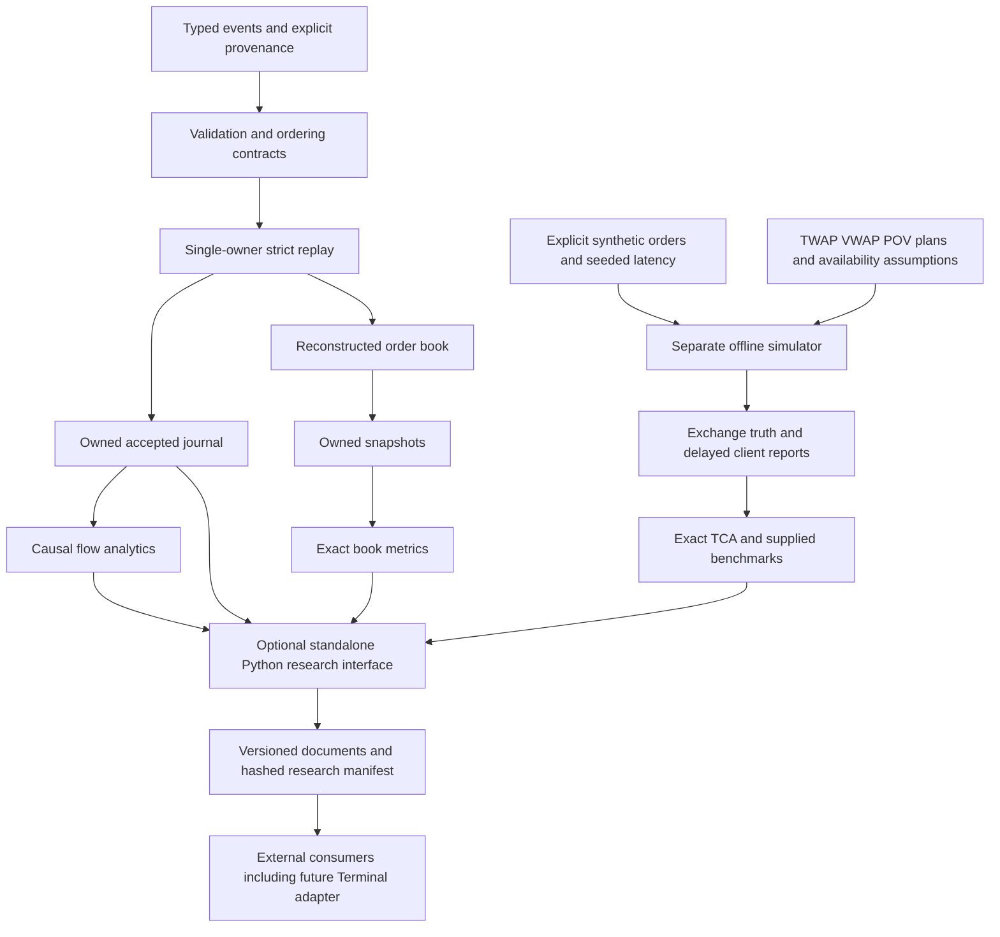

# Phases 3–9 completion and acceptance

Authorized offline research scope is complete with the explicit evidence limits
below. No release was published, no merge into main was performed, and GIG Quant
Terminal was not modified. Branch: `feat/bootstrap-cpp20-engine`.

Starting verified SHA: `511ae18c9eff750dda346e9c1cc13571a6594bee` (Phase 2 boundary).
Phase 9 start: `c0a32fddbf57218be32afc918cd2696324c3bfb5`.
Final validation/tools checkpoint: `36413f78b952a51d2489c0ad4c0da85e7094151e`.
This report and raw evidence are finalized in their containing commit; its exact
ending SHA is available with `git log -1 --format=%H -- docs/FINAL_REPORT.md` and
reported to the user after normal push/remote verification. A file cannot contain
its own Git commit hash. Main is preserved at
`165c5038336887116d69160b0d8e5a1a5ef59d16`.

## Implementation and architecture

Checked strong units and validated events feed a deterministic single-owner
order-level reconstruction/replay engine with FIFO, scoped IDs, atomic logical
mutations, strict multi-stream sequencing, explicit reset/recovery and owned
accepted-event lineage. Historical replay does not match orders. Exact immutable
book metrics and causal windowed quote/trade/flow analytics reference parent runs,
journal prefixes, rules and sessions. A separate bounded synthetic matching model
has seeded latency, cancel races, exchange truth and delayed client reports.
Offline TWAP/VWAP/POV planning and exact transaction costs consume explicit profiles,
volume prefixes, fees and benchmarks. The optional Python interface exposes these
research components through exact schema1.0 owned documents and hashed exports.

No network feed adapter, broker, live trading, Terminal build dependency, concurrency,
lock-free structures or speculative storage optimization was introduced.

## Completion matrix and durable checkpoints

All implementation and evidence commits below were normally pushed and exact remote
SHAs verified before continuing. Existing history and the development branch remain.
Each PHASE_n_REPORT.md includes its changed paths, contracts, independent checks,
actual tests, benchmarks, assumptions, limitations and acceptance decision.

| Phase | Implemented/validated scope | Code commit | Evidence boundary |
|---|---|---|---|
| 3 | Exact book metrics, unavailable states and parent lineage; 50/50 each native mode | `08933879fdb7ac0899ae1de30f5c6a3a98321c57` | `0620b4c2e48d8aae317143dfecf9ed3185bc3c58` |
| 4 | Causal signing, OFI, intensities, spreads/impact and sampled variance; 52/52 | `a1d0644dff8a3446ac5417f2442234edb566ab99` | `dee6ff3869bd8692f3e484a696d338eb7b1736da` |
| 5 | Atomic separate matching/latency/queue model; 57/57 | `bc9a1b57c6ce138ebefcd8d0bba98366258f5385` | `1f747482b664f6437a5ce10cedc4809d30cf3683` |
| 6 | Causal execution schedules, inventory and exact TCA; 61/61 | `a5340f99dbac1dca6cc187086e374d3827fee04c` | `a63a7d5d11e04244a8e1c89861bb860858949e64` |
| 7 | Common-code raw baselines, allocation/RSS and scoped profiles; no justified optimization | `5707417ba2ae705fff45f0cc53a280dd33de9473` | `874bd59f72aa69d8a37591896ecfda6650b8a63b` |
| 8 | Pinned Python interface, 14 schemas, ownership/provenance export, private wheel; 63/63/64 | `ce44faa6d53abe40c928d7d4bfb07ece94c70fd2` | `c0a32fddbf57218be32afc918cd2696324c3bfb5` |
| 9 | Fresh GCC/Clang matrix, canonical reproduction, packaging, security/license review, final guides | `36413f78b952a51d2489c0ad4c0da85e7094151e` | Containing final evidence/report commit |

Phase 7's optimization comparison is conditionally inapplicable: coarse profiling
identified no sufficiently supported maintainable optimization. No speedup was
invented. Native ARM and hosted CI were unavailable; the mandate explicitly allows
disclosed local completion in those circumstances.

## Correctness and numerical evidence

The inherited oracle executes 20,000 seeded book operations with 1,318,396 assertions;
34 book and 30 replay real allocation-failure positions test atomicity. Phase 1's
strong-type/numeric boundaries and malformed-event checks remain active.
New independent arbitrary-precision Python references cover 2,650 book metric cases
(seed3071), 2,000 flow cases (4099), 1,000 synthetic matcher/cancel states
(5/42/1729/2027), 2,600 execution/cost cases (6011), and 300 Python Fraction cases
(8033). Hand calculations include missing/one-sided/locked books, unsigned maximum
quantities, bounded signed128 intermediates, zero denominators, horizon causality,
zero jitter/deterministic latency races, FOK/IOC/post-only, exact largest-remainder
allocations and cost decomposition. No floating rounding substitutes for tick/lot
validation. Volatility sqrt alone is explicitly approximate long double.

Additional real failure injection reaches two flow, 28 simulator, six planner,
42 integrated execution and one TCA output allocation positions. Tests compare
logical state and owned source lineage, not merely success codes. All eight event
families and missing metadata traverse Python/schema boundaries. Duplicate keys,
invalid enums, float/bool integer coercions, incompatible versions, lifetime expiry,
resource limits and export tampering/incomplete markers are tested.

Final Phase 9 local results (Linux x86_64, warnings as errors):

| Configuration | Debug | Release | ASan + UBSan |
|---|---|---|---|
| Fresh GCC14.2 native, Python bindings OFF | 61/61 | 61/61 | 61/61 |
| Fresh Clang19.1.7 native, Python bindings OFF | 61/61 | 61/61 | 61/61 |
| GCC14.2 optional Python, repeated Phase 9 | 63/63 | 63/63 | 64/64 |

Zero failed/skipped/disabled outcomes. Core ASan includes normal exit-time leak
checks. Optional Python sanitizer checks cover the active interpreter and include
an intentional-leak detection control. Stock CPython shutdown leakage was isolated
without engine imports; late interpreter-finalization leaks remain UNVERIFIED.
See PHASE_8_REPORT.md for controls, preload requirements and precise settings.
This qualification must accompany the Python sanitizer result.

Canonical demo bytes (3,792 bytes) agree in all six fresh native configurations:
`bee1448c29fc918911c48e62a6f6060d09d3e53f0938a02f4e4063b49d362979`.
All native benchmark canonical artifact hashes exactly reproduce Phase 7.
Python benchmark input and result exactly reproduce Phase 8:
`f1288cc88c4da2539f7f1c7e28b310f71c4ad07cb81cdb32338eb42849cba1c1`
and `6503413a860da1800ab06e846f504a338d73ebd8078c33dac7346448a0df0fda`.

Native x86_64 GCC/Clang VERIFIED. Native ARM64 NOT TESTED (no hardware);
ARM cross-compilation NOT PERFORMED. Windows/macOS NOT TESTED. MSVC's lack of the
required compiler128 facility is unsupported by the current exact-rational code.
Only CPython3.12/Linux was locally exercised; other declared Python versions are
compatibility targets, not verified results. Hosted GitHub Actions UNVERIFIED:
latest checks API probe returned proxy CONNECT403 (curl56). Git push success is
not CI success. Six local native configurations cover the workflow's compiler/
preset combinations; packaging/Python/schema checks also ran locally.

## Performance evidence

Raw original evidence: baselines/phase3-book-metrics.json through phase6 execution
report links; baselines/phase7-engine.json and phase7-gprof.json; and
baselines/phase8-python-interface.json. Final independent clean-checkpoint repeat:
[core raw manifest](baselines/phase9-engine.json) and
[Python raw manifest](baselines/phase9-python-interface.json), both code
`36413f78b952a51d2489c0ad4c0da85e7094151e`, dirty=false.
Each runner reran correctness checks before timing. Build flags, compiler, CPU,
affinity, hashes, seven repetitions, warmups, all raw samples and memory scopes are
retained. See PHASE_7_METHODOLOGY.md and PHASE_8_INTERFACE.md for exact definitions.

Native table below reports wrapper operations/s and separately measured serial
service times. These include specified checksum/lifecycle/clock overhead, not
network arrival latency. Matching rows time submit+advance; execution rows time
plan+TCA on a prevalidated simulated parent. Python includes schema/conversion/
owned document/native journal cost. No inter-row equivalence is implied.

| Workload | Median operations/s | p50 ns | p95 ns | p99 ns | Worst ns |
|---|---:|---:|---:|---:|---:|
| book_analytics | 2,596,157.8 | 440 | 471 | 491 | 53058 |
| add | 1,528,344.5 | 621 | 1562 | 1893 | 36634 |
| cancel | 2,413,591.5 | 430 | 962 | 1291 | 51907 |
| depth_snapshot | 5,037,932.1 | 230 | 241 | 261 | 24697 |
| event_copy_add | 3,673,806.2 | 310 | 872 | 1172 | 1552 |
| event_copy_snapshot | 5,437,668.6 | 220 | 260 | 271 | 311 |
| execution | 2,386,223.3 | 380 | 1122 | 1362 | 42233 |
| payload_copy | 331,821,127.7 | 30 | 31 | 40 | 180 |
| replay | 55,651.3 | 9644 | 11837 | 40330 | 4338252 |
| execution_tca | 808,505.7 | 1002 | 1202 | 2053 | 204240 |
| flow_analytics | 707,345.8 | 952 | 1562 | 3705 | 3331210 |
| simulation | 120,320.5 | 5178 | 17776 | 75852 | 127758 |

Python repeat: median764.7 events/s, p50 1,247,225ns, p95 3,338,683ns,
p99 7,881,528ns, worst286,592,662ns across1,792 separate service observations.
The large observed tail is retained, not excluded. Shared-host scheduling/frequency
is uncontrolled; no production, ultra-low-latency or improvement claim is supported.
Nearest-rank percentiles describe finite observations, not population guarantees.
Native post-exec VmHWM and wait-accounted RSS are both retained: the latter can
include the Python worker's inherited floor. PMR is separately scoped, excluding
Python/native driver allocations and allocator overhead. Profiling used coarse
10ms gprof samples; optimized helper attribution is weak. No optimization applied.

## Python, integration and reproducibility

[Python interface guide](PHASE_8_INTERFACE.md), standalone
`examples/python_research.py`, and [Terminal consumer contract](GIG_INTEGRATION.md)
cover events/replay/snapshots/metrics/simulation/plans/TCA, structured errors,
ownership and schema1.0. All64-bit integer fields use exact decimal strings.
Schemas reject unknown versions and require companion arbitrary-integer bound
validation; schema annotations alone are not domain validation. Inputs, seeds,
profile availability/oracle labels and parent references survive exports.

[Reproduction commands](REPRODUCIBILITY.md) include native/Python modes and private
wheel/sdist builds. Phase 9 built a wheel and sdist, rebuilt that sdist into a wheel,
and tested both installed wheels in an independent consumer: seven test groups
passed each (0.683s and0.619s), all14 schemas and notices present, installed path
verified. Both examples produce identical SHA256
`287f373a245dff61c40c8a08e47aace216573f4d9240533e5a7656491f97efcf`.
Exact private artifact hashes and packaging-source qualification are in
[validation evidence](baselines/phase9-validation.json). Initial packaging occurred
while documentation/tool changes were present; runtime code was unchanged since
the verified Phase 8 implementation. Byte-identical binary rebuilds are not claimed.
No artifact was uploaded or release published.

## Security, provenance and license review

[Review boundaries](SECURITY_AND_DEPENDENCIES.md) and
[dependency inventory](baselines/phase9-dependency-review.json) retain dated PyPI
responses, actual license metadata/files and all12 locked wheel digests. All hashes
matched, all12 advisory endpoints were available, and no active advisories were
reported for those pinned versions. This is not a complete platform/CVE audit or
upstream source-signature guarantee. Compiler archives matched signed Debian
metadata; [package identities/hashes](baselines/phase9-clang-packages.json) retained.
The limited secret-pattern scan found zero matches; it is not exhaustive.

All example/benchmark data is synthetic. No restricted dataset, external credential,
paid resource, live connection or Terminal modification was required. Own source
remains private without a public license grant; pybind11 notice is retained. Input
hashes protect integrity, not authenticity; dataset rights, caller completeness
assertions and the entire parent provenance graph require independent review before
external research use. No public redistribution is authorized.

## Acceptance, remaining risks and next work

- PASS: required offline implementation, contracts, independent numeric/reference
  validation, regression/failure-safety tests and deterministic outputs.
- PASS: Debug/Release/ASan/UBSan native GCC+Clang; optional Python checks with the
  explicit active-interpreter leak qualification above.
- PASS: correctness-gated native/Python benchmark reproduction, raw measurements and
  memory/allocation scope; no unsupported optimization claim.
- PASS: private package/sdist consumer tests, schema compatibility, security/license/
  provenance review, guides and GitHub checkpoint durability.
- UNVERIFIED: hosted Actions (restricted API), native ARM64, Windows/macOS,
  other CPython versions, late interpreter-finalization leaks. These are not passes.
- NOT CLAIMED: production readiness, exchange certification, exhaustive security,
  observed-data validity, public release or native ARM/cross-compile validation.

Remaining bounded-model risks: no auctions/hidden/pro-rata/pegged/STP/routing or
exchange-specific corrections; incomplete/aggregate feeds cannot establish FIFO;
strict replay does not reorder/fabricate; fixed snapshot/query/resource bounds;
large owned journals and full simulator state clones; checked128 intermediate
rejection; approximate volatility sqrt; assumed clocks/completeness/latencies;
queue truth differs from client knowledge; conservative POV may underexecute;
no calibrated Kyle/VPIN/impact inference. Exports are not crash-safe database
transactions or authenticated provenance graphs. See LIMITATIONS.md and individual
contracts for exact error and ownership behavior.

Future research requires new authorization: real-feed adapter with licensed data
and explicit mapping, empirical clock/latency/impact calibration, native ARM and
broader Python/platform CI, deeper fuzzing/security checks, independently reviewed
crash durability, and one measured storage optimization at a time. Calibrated Kyle/
VPIN and concurrency are research questions, not missing production features to
add speculatively. [Interview preparation](INTERVIEW_GUIDE.md) explains design,
complexity, precision, alternatives and evidence limits.

Phase 9 completes the authorized mandate with these disclosed limitations. Stop
here; no further phase, live integration, Terminal change, merge or release follows
without explicit authorization. A reusable environment setup/start draft was saved;
it is not applied/published and restoration has not been independently verified.

## Complete changed-file inventory since Phase 2

- `.github/workflows/ci.yml`
- `.gitignore`
- `CMakeLists.txt`
- `README.md`
- `THIRD_PARTY_NOTICES.md`
- `benchmarks/CMakeLists.txt`
- `benchmarks/book_benchmark.cpp`
- `benchmarks/execution_benchmark.cpp`
- `benchmarks/flow_benchmark.cpp`
- `benchmarks/memory_stats.hpp`
- `benchmarks/research_benchmark.cpp`
- `benchmarks/simulation_benchmark.cpp`
- `docs/ARCHITECTURE.md`
- `docs/AUTONOMOUS_MANDATE.md`
- `docs/FINAL_REPORT.md`
- `docs/GIG_INTEGRATION.md`
- `docs/INTERVIEW_GUIDE.md`
- `docs/LIMITATIONS.md`
- `docs/MICROSTRUCTURE_METRICS.md`
- `docs/PHASE_3_CONTRACTS.md`
- `docs/PHASE_3_REPORT.md`
- `docs/PHASE_4_CONTRACTS.md`
- `docs/PHASE_4_REPORT.md`
- `docs/PHASE_5_CONTRACTS.md`
- `docs/PHASE_5_REPORT.md`
- `docs/PHASE_6_CONTRACTS.md`
- `docs/PHASE_6_REPORT.md`
- `docs/PHASE_7_METHODOLOGY.md`
- `docs/PHASE_7_REPORT.md`
- `docs/PHASE_8_INTERFACE.md`
- `docs/PHASE_8_REPORT.md`
- `docs/PHASE_9_REPORT.md`
- `docs/REPRODUCIBILITY.md`
- `docs/SECURITY_AND_DEPENDENCIES.md`
- `docs/VALIDATION.md`
- `docs/baselines/phase3-book-metrics.json`
- `docs/baselines/phase4-flow-metrics.json`
- `docs/baselines/phase5-simulation.json`
- `docs/baselines/phase6-execution-tca.json`
- `docs/baselines/phase7-engine.json`
- `docs/baselines/phase7-gprof.json`
- `docs/baselines/phase8-python-interface.json`
- `docs/baselines/phase9-clang-packages.json`
- `docs/baselines/phase9-dependency-review.json`
- `docs/baselines/phase9-engine.json`
- `docs/baselines/phase9-python-interface.json`
- `docs/baselines/phase9-validation.json`
- `examples/python_research.py`
- `fixtures/synthetic/execution.hpp`
- `fixtures/synthetic/simulation.hpp`
- `include/gig/analytics/book_metrics.hpp`
- `include/gig/analytics/exact.hpp`
- `include/gig/analytics/flow_metrics.hpp`
- `include/gig/execution/execution.hpp`
- `include/gig/simulation/simulator.hpp`
- `pyproject.toml`
- `python/bindings/build_info.hpp.in`
- `python/bindings/module.cpp`
- `python/bindings/results.hpp`
- `python/bindings/schemas.cpp`
- `python/bindings/wire.cpp`
- `python/bindings/wire.hpp`
- `python/gig_microstructure/__init__.py`
- `python/gig_microstructure/manifest_schema.py`
- `requirements-python.lock`
- `schemas/cost_config-v1.schema.json`
- `schemas/flow_config-v1.schema.json`
- `schemas/flow_quote-v1.schema.json`
- `schemas/flow_trade-v1.schema.json`
- `schemas/gig.book_snapshot-v1.schema.json`
- `schemas/gig.event-v1.schema.json`
- `schemas/gig.execution_schedule-v1.schema.json`
- `schemas/gig.metric_result-v1.schema.json`
- `schemas/gig.run_manifest-v1.schema.json`
- `schemas/gig.simulation_output-v1.schema.json`
- `schemas/instrument_rules-v1.schema.json`
- `schemas/plan_config-v1.schema.json`
- `schemas/replay_config-v1.schema.json`
- `schemas/simulation_config-v1.schema.json`
- `scripts/benchmark_python.py`
- `scripts/check_book_metrics.py`
- `scripts/check_execution_reference.py`
- `scripts/check_flow_metrics.py`
- `scripts/check_python_lsan_control.py`
- `scripts/check_simulation_reference.py`
- `scripts/generate_schemas.py`
- `scripts/measure_benchmark_child.py`
- `scripts/review_dependencies.py`
- `scripts/run_engine_baseline.py`
- `scripts/run_python_sanitized.py`
- `scripts/run_research_benchmark.py`
- `src/analytics/book_metrics.cpp`
- `src/analytics/flow_metrics.cpp`
- `src/execution/execution.cpp`
- `src/simulation/simulator.cpp`
- `tests/python_fixtures.py`
- `tests/test_book_metrics.cpp`
- `tests/test_execution.cpp`
- `tests/test_flow_metrics.cpp`
- `tests/test_python.py`
- `tests/test_simulation.cpp`
