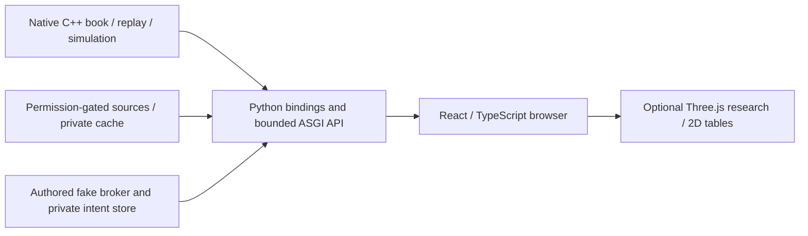

# Explain the architecture accurately

GIG ATLAS is a private quantitative research terminal built around a deterministic C++20 microstructure engine. It is not an exchange implementation or a production trading system.

`include/gig/` and `src/` contain strong numeric types, validated events, L3/FIFO/replay/recovery, exact metrics, synthetic matching/execution and source adapters. Exact integer/rational contracts avoid silently rounded prices/lots/overflow. Independent native reference models and frozen canonical identities support the tested deterministic behavior. Native state has one owner; synthetic exchange behavior does not prove exchange-specific market equivalence.

`python/gig_microstructure` exposes native calculations with validated C++/Python boundaries. `terminal/server` owns APIs, bounded work, exact Origin/Host validation, one-use endpoint-bound proofs for known Codespaces rewriting and native/browser transport. Forwarded headers alone never establish authority. Private Codespaces authentication belongs to the actual deployment boundary, not a localhost fixture.

`terminal/stocks` separates identity, SEC selected facts/PIT metadata, permission-gated IEX observations, exact descriptive analytics and bounded research models. Discovery is independent of financial coverage and entitlement. Browser SSE projects bounded recent states; source sequence/correction/reconnect gaps remain explicit. The native replay WebSocket is a separate stream.

`terminal/web` keeps backend financial calculations authoritative, handles missing/stale data honestly and lazily loads optional Three.js. Fifteen existing modes map explicit data/parameters; L1 never creates L3 depth. The response reader checks declared/actual bytes before accumulation and decoding, not after `Response.text()` has consumed the body.

`terminal/paper` is isolated authored-only durable intent/risk/reconciliation infrastructure. SQLite commit-before-send, stable client identity, reservations, uncertain-state blocking, kill and explicit cancellation reconciliation address failure boundaries. Sprint4 adds a fixed-paper-host broker transport and exact ledger adapter,implemented but disabled and never provider-qualified. A fake coherent snapshot is not evidence of a real broker's atomic account view. Native simulation is separate and unchanged.

C++ provides explicit state/numeric invariants and native tooling; Python connects data/model/workflow validation; TypeScript presents bounded, provenance-aware interaction. This division does not prove low latency. Report actual measured workloads, compilers, seeds, resource bounds and limitations. No microservices, paid services or trading path are needed to demonstrate these engineering ideas.

Sprint4 separates three transports/data contracts:explicit-feed historical reads,shared liveIEX source/browser projection,and independently authorized paper execution. A fixed-host bounded HTTP reader rechecks policy before obtaining credentials,refuses redirects/compressed bodies and enforces raw byte limits. Historical revisions carry page hashes/physical counts;accepted bars feed causal trailing research without inventing best quotes or depth. Exact-endpoint comparisons avoid nearest-neighbor imputation.

Paper intents commit before any send. Exact fills use individual activity records;rounded average prices cannot serve as the cash ledger. Duplicate/lost acknowledgments,unknowns,cancel races and restart use the same durable risk engine with independently authored protocol fixtures. Stable double-read is a limited consistency check,not an atomic broker snapshot. Exclusive-account assumptions,whole-share/exact-cent restrictions and separate risk/permission/session gates are explicit limitations,not operational certification.
